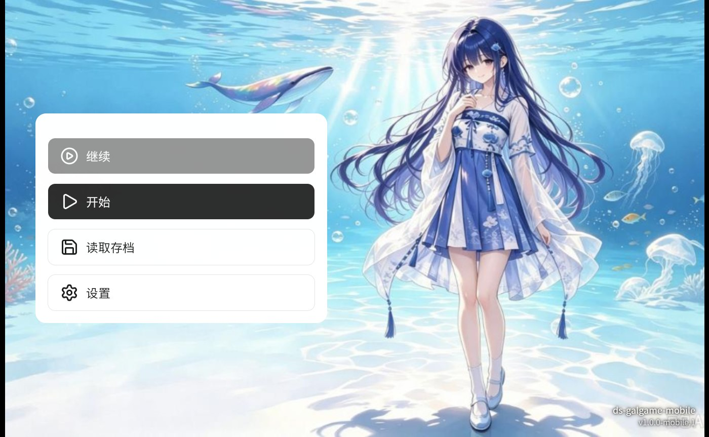
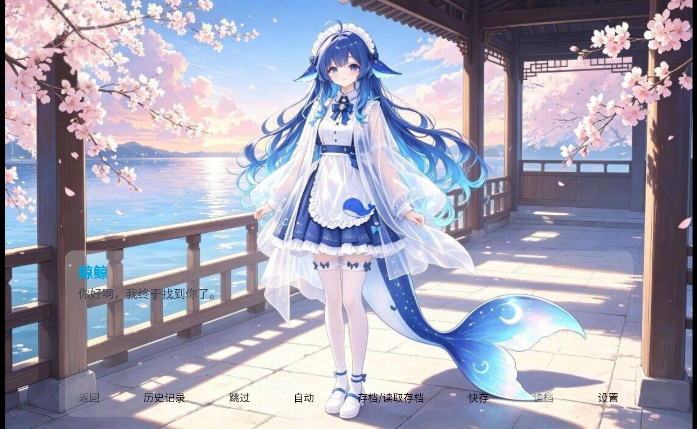
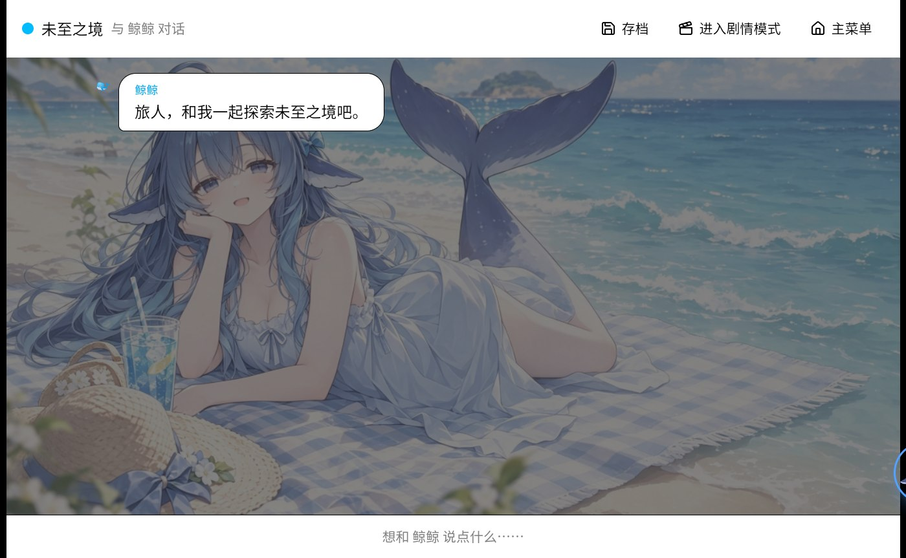
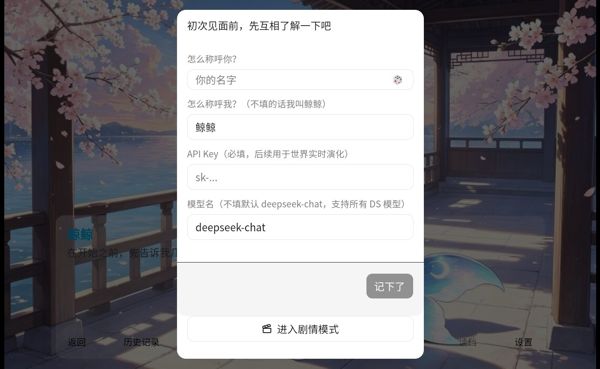

# 深海回响 · 手机版

> ⚠️ **转载须知名**：本仓库内容（代码与素材）**转载必须注明原作者与出处**，**禁止任何商业使用**。

以 DeepSeek 鲸鱼娘为主角的横屏 Galgame。对话由你自己的 DeepSeek API Key 驱动——聊到什么，她就换什么表情、什么场景，并且记得你们聊过的事。

安卓手机横屏游玩，也可以直接当 PWA 部署到任意静态托管。



## 直接下载安装（不需要 Git）

打开 [Releases](https://github.com/zzu20137670613/ds-galgame-mobile/releases) 下载 APK，传到手机上安装即可（横屏游玩）。

> 首次进入需要在开场设定里填入你自己的 DeepSeek API Key（用于世界实时演化）。

## 界面一览

| 对话演出 | 日常聊天（桌宠在右下角） |
|---|---|
|  |  |

开场设定表单（玩家名 / 鲸鱼娘名 / API Key / 模型名）：



## 功能

- **横屏 Galgame 演出**：立绘 / 背景 / 贴纸三槽位随剧情自动切换
- **自由对话**：没有选项，直接说话，世界因你而动
- **记忆**：长期记忆注入 + 全量上下文存档
- **存档 / 读档**：快存、格子存档、退出自动存，与对话上下文绑定
- **桌宠**：右下角鲸鱼娘，点开看 API 余额与峰谷时段，可拖动
- **换肤**：想换成你家 AI，见下方「想把主角换成你家 AI？」

## 从源码运行（浏览器 / PWA）

```bash
git clone https://github.com/zzu20137670613/ds-galgame-mobile.git
cd ds-galgame-mobile
npm install
npm run dev
```

手机连同一个 WiFi，打开终端给出的局域网地址（如 `http://192.168.x.x:5173`）即可。

`npm run build` 产物在 `dist/`，可直接部署到 Vercel / Netlify / GitHub Pages / 自建 Nginx；PWA 已配置完毕，浏览器里「添加到主屏幕」即为全屏横屏体验。

## 打包安卓 APK

前置：**JDK 21** + Android SDK，并让 Gradle 能找到 SDK（设置环境变量 `ANDROID_HOME`，或写 `android/local.properties` 里的 `sdk.dir`）。

```bash
npm run build            # 生成 dist/
npx cap sync android     # 同步 web 产物到 android/
cd android && ./gradlew assembleDebug
# 产物：android/app/build/outputs/apk/debug/app-debug.apk
```

## 与桌面版的区别

桌面版（Electron + exe 安装包）在 [ds_galgamePC](https://github.com/zzu20137670613/ds_galgamePC)。

| | 桌面版 | 移动版（本仓库） |
|---|---|---|
| 形态 | Electron + NSIS 安装包 | 安卓 APK / PWA |
| 存档 | IndexedDB + 本地文件双轨 | IndexedDB |
| API 转发 | Electron 主进程代理 | 浏览器直接 fetch |
| 布局 | 固定 1280×800 窗口 | 16:10 弹性适配横屏（两端自动补黑条） |
| 触控 | 鼠标为主 | 按钮 / 图标按手指尺寸放大 |
| 键盘 | 物理键盘 | 软键盘弹起时画布不动、输入面板贴键盘 |
| 图片裁剪 | 居中 | 优先裁下方（底:顶 = 3:1） |
| 横屏锁定 | 无 | 全屏 + Screen Orientation API |

两个仓库共享同一套 React + PIXI + PixiVN 骨架；移动版通过抽象层把 Electron 独有能力降级成 IndexedDB / fetch 兜底——是平台能力差异，不是逻辑分叉。

## 老旧安卓 WebView 兼容（踩坑记录）

安卓 9 及以下系统自带的 WebView（Chromium 91 级别）不支持一批较新的语法，且对不认识的语法会**整条丢弃**，踩过的坑与对策：

| 语法 | 影响 | 对策 |
|---|---|---|
| `@layer`（Chromium 99+） | 样式整块失效，界面完全裸奔 | 改成无层导入 `tailwindcss/theme.css` 等 |
| `@media (width>=40rem)`（Chromium 104+） | `sm:` / `md:` / `lg:` 响应式类全部失效 | 构建期用 Lightning CSS 按 chrome 91 目标降级为 `min-width` |
| `translate` / `scale` 独立变换属性（Chromium 104+） | 居中元素跑到右下角、被裁切 | `src/styles.css` 里用 `@supports not (translate:1px)` 补 `transform` 兜底 |
| `AbortSignal.timeout`（Chromium 103+） | 方法不存在会抛错，且错误信息含 `timeout` 会被误判成网络故障 | 改用 `AbortController` + `setTimeout` |
| `oklch()`（Chromium 111+） | 颜色变量无效、变透明 | 颜色变量只写 hex / rgba |

降级逻辑集中在 [vite.config.ts](./vite.config.ts) 的 `legacyCssCompatPlugin` 与 [src/styles.css](./src/styles.css)，只在构建产物上生效，不影响现代浏览器。

## 想把主角换成你家 AI？

立绘、背景、贴纸怎么换，都在 [HANDOFF.md](./HANDOFF.md) 里：素材目录 + 触发词索引（`src/lib/materials/material-index.ts`）+ 要一并改的品牌字符串。仓库还附了一个配套 Skill（[`.trae/skills/gal-brand-replace/SKILL.md`](./.trae/skills/gal-brand-replace/SKILL.md)），如果你的 AI 搭档支持读取 Skills，可以直接让它照着干活。移动版和桌面版共用同一套素材体系，换一次两边生效。

## 文档索引

- [MOBILE.md](./MOBILE.md) — 移动端适配规约（新增代码需遵守）
- [VERSION.md](./VERSION.md) — 版本记录
- [HANDOFF.md](./HANDOFF.md) — 素材体系与换主角
- [HIDDEN-STORY.md](./HIDDEN-STORY.md) — 隐藏剧情

## 许可

GPL-3.0，全文见 [LICENSE](./LICENSE)。
